# LifeOS — Entity-Relationship Model (docs/ERD.md)

> Derived directly from `prompt.md` §7.3 ("Data model (Drizzle, SQLite/libSQL) — refine, then
> document in docs/ERD.md"). This is the Phase-0 refinement: table inventory, column contracts,
> relationship graph, indexes, and the conventions every table obeys. Drizzle schema files are
> written against this doc in Phase 1+; changes here are logged in `docs/DECISIONS.md` first.

## 0. Conventions (spec §7.3)

| Rule                | Value                                                                                                                                                              |
| ------------------- | ------------------------------------------------------------------------------------------------------------------------------------------------------------------ |
| Primary keys        | `id` text — ULID (decision `ADR-008`; cuid2 was the spec's alternative)                                                                                            |
| Timestamps          | `created_at`, `updated_at` as **integer milliseconds UTC**; no SQL `datetime`                                                                                      |
| Soft delete         | `deleted_at` (nullable) where restore is meaningful; hard delete only for account deletion flows                                                                   |
| Ownership           | every user-owned table has `user_id` **and** a reserved nullable `workspace_id` (teams are a v1 non-goal, spec §15, but the column ships now to avoid a migration) |
| Every query         | filters by the authenticated owner (spec §10 tenant isolation); Drizzle queries always include `user_id`                                                           |
| Ordering            | kanban/card order is `position TEXT` = fractional index (spec §7.3, research (d) §1 — never integer ranks)                                                         |
| Concurrency         | mutable cards carry `version INTEGER` for optimistic-concurrency checks (research (d) §2)                                                                          |
| Recurrence          | `recurrence TEXT` holds an RFC 5545 `RRULE` string (`rrule` library, library table #43)                                                                            |
| JSON columns        | SQLite `TEXT` holding validated JSON; shape enforced by Zod at the service boundary, not in SQL                                                                    |
| IDs shown to humans | ULIDs sort by time, so cursor pagination on `(user_id, created_at, id)` needs no extra index                                                                       |

## 1. Relationship graph (Mermaid)

```mermaid
erDiagram
    users ||--o{ sessions : "owns"
    users ||--o{ accounts : "oauth link"
    users ||--o{ verifications : "email flows"
    users ||--o{ api_keys : "issues"
    users ||--o| user_settings : "has"
    users ||--o{ workspaces : "member of"
    workspaces ||--o{ workspace_members : "future teams"
    users ||--o{ audit_log : "acts"

    users ||--o{ boards : "owns"
    boards ||--o{ board_columns : "columns"
    boards ||--o{ custom_fields : "field defs"
    boards ||--o{ cards : "contains"
    board_columns ||--o{ cards : "holds"
    cards ||--o{ card_labels : ""
    labels ||--o{ card_labels : ""
    labels }o--|| boards : "scoped to board"
    cards ||--o{ checklists : ""
    checklists ||--o{ checklist_items : ""
    cards ||--o{ comments : ""
    cards ||--o{ attachments : ""
    cards ||--o{ custom_field_values : ""
    custom_fields ||--o{ custom_field_values : ""
    cards ||--o{ card_links : "src"
    cards ||--o{ card_links : "dst"
    cards ||--o{ saved_views : "optional pinned filter"

    cards ||--o| job_applications : "kind=job card"
    job_applications }o--|| companies : "company"
    job_applications }o--o{ contacts : "referrers"
    companies ||--o{ contacts : "work at"
    job_applications ||--o{ interviews : ""
    job_applications ||--o{ offers : ""
    job_applications }o--|| resumes : "tailored CV"
    resumes ||--o{ resume_versions : "snapshots"
    resumes ||--o{ custom_field_values : "n/a"

    users ||--o{ skills : ""
    users ||--o{ achievements : ""
    users ||--o{ projects : "portfolio"
    users ||--o{ star_stories : "interview prep"
    users ||--o{ question_bank : "interview prep"
    users ||--o{ coding_problems : "interview prep"
    projects }o--o{ cards : "card_links"

    users ||--o{ habits : ""
    habits ||--o{ habit_logs : "per day"
    users ||--o{ goals : ""
    goals ||--o{ key_results : ""
    goals ||--o{ goal_links : "links cards/boards"

    users ||--o{ notes : ""
    notes ||--o{ note_links : "backlinks"
    tags }o--o{ taggings : ""
    notes ||--o{ taggings : ""

    users ||--o{ accounts_fin : "finance"
    accounts_fin ||--o{ transactions : ""
    users ||--o{ budgets : ""
    users ||--o{ subscriptions_tracked : ""
    users ||--o{ health_logs : ""
    users ||--o{ courses : ""
    users ||--o{ books : ""
    users ||--o{ focus_sessions : ""
    users ||--o{ time_entries : ""
    users ||--o{ reviews : ""
    users ||--o{ notifications : ""
    users ||--o{ reminders : ""
    users ||--o{ automations : ""
    automations ||--o{ automation_runs : ""
    users ||--o{ webhooks_out : ""
    webhooks_out ||--o{ webhook_deliveries : ""
    users ||--o{ ai_conversations : ""
    ai_conversations ||--o{ ai_messages : ""
    users ||--o{ ai_usage : "counters"

    users ||--o{ subscriptions : "billing"
    subscriptions ||--o{ billing_events : "dedupe by event id"
    users ||--o{ entitlements : "can/limit reads"
```



Notes on edges the spec calls out explicitly:

- `job_applications.card_id FK` (spec line 356): a job application **is backed by a card** on the
  jobs board — the card gives it kanban columns/drag/position, the application row gives it career
  fields. One-to-one: `cards.id` ← `job_applications.card_id` (UNIQUE), used when
  `cards.kind = 'job'`.
- `card_links` is polymorphic ("link between any two entities"): `(src_type, src_id, dst_type,
dst_id, link_kind)` with a CHECK that src/dst ids exist is impractical in SQLite, so integrity is
  enforced in the service layer and an index covers `(src_type, src_id)` + `(dst_type, dst_id)`.
- `resumes.ats_score` stays nullable: honest ATS reporting (research (d) §4) means a
  **parse-fidelity score + checklist**, computed on export, not a magic number the user types.
- `resumes.data` is validated against the **JSON Resume schema** (`@jsonresume/schema` 1.3.1,
  library table #33), which is why work/education/awards can be empty-but-present.

## 2. Table contracts

Column types below are Drizzle `sqliteTable` intent: `text`, `integer` (ms epoch / booleans as
0|1), `real`, JSON-as-text. Enumerations are `text` + Zod unions at the boundary (SQLite has no
enums). Every row also carries `created_at`/`updated_at` and, where noted, `deleted_at`.

### 2.1 Identity (spec line 354)

| Table               | Key columns beyond conventions                                                                                                                                                                                                                                                                                 |
| ------------------- | -------------------------------------------------------------------------------------------------------------------------------------------------------------------------------------------------------------------------------------------------------------------------------------------------------------- |
| `users`             | `email` UNIQUE, `email_verified_at`, `name`, `image`, `bio`, `locale`, `timezone`, `week_start`, `onboarded_at`, `is_demo` (0\|1, seed rows removable per spec §12), `joined_during_free_period` (spec §11 founder grandfathering)                                                                             |
| `sessions`          | Better Auth shape: `token` UNIQUE, `user_id`, `expires_at`, `ip`, `user_agent`                                                                                                                                                                                                                                 |
| `accounts`          | Better Auth OAuth link: `provider_id`, `account_id`, `user_id`, `access_token`/`refresh_token` (encrypted where present), `scope`                                                                                                                                                                              |
| `verifications`     | Better Auth email-verify/reset: `identifier`, `value`, `expires_at`                                                                                                                                                                                                                                            |
| `api_keys`          | `name`, `prefix` (display, e.g. `lifeos_live_ab12…`), `hash` (SHA-256 of full key), `scopes` (JSON array of `read:*` / `write:tasks` / `admin:export`), `last_used_at`, `expires_at`, `revoked_at` (spec §9.1)                                                                                                 |
| `workspaces`        | `name`, `slug`, `owner_user_id` — reserved for future teams                                                                                                                                                                                                                                                    |
| `workspace_members` | `workspace_id`, `user_id`, `role` — future (spec §15: schema ready, no UI)                                                                                                                                                                                                                                     |
| `user_settings`     | `theme`, `theme_overrides` JSON (customizer: preset/font/color-mode/radius/content-layout/scale/sidebar-variant/sidebar-mode — spec §3), `shortcuts` JSON (remappable, spec §10 keyboard), `locale`, `timezone`, `week_start`, `ai_prefs` JSON (provider, model, auto-approve allowlist, morning-brief opt-in) |
| `audit_log`         | `actor` (`user:<id>` \| `ai` \| `api:<key id>` \| `mcp:<client>` \| `webhook:<id>`), `action`, `entity_type`, `entity_id`, `metadata` JSON, `request_id` (spec §10)                                                                                                                                            |

### 2.2 Boards engine (spec line 355)

| Table                            | Key columns                                                                                                                                                                                                                                                                                                                                        |
| -------------------------------- | -------------------------------------------------------------------------------------------------------------------------------------------------------------------------------------------------------------------------------------------------------------------------------------------------------------------------------------------------- |
| `boards`                         | `name`, `slug`, `template` (from Phase-8 gallery), `view_config` JSON (default view + visible views: table/kanban/calendar/grid/timeline), `card_fields` JSON (visible fields/order), `archived_at`, `is_demo`                                                                                                                                     |
| `board_columns`                  | `board_id`, `name`, `color`, `glyph`, `position` (fractional), `wip_limit` (nullable → TUI meter), `is_done` (0\|1; done column completes on drop)                                                                                                                                                                                                 |
| `cards`                          | `board_id`, `column_id`, `position` (TEXT fractional), `title`, `description` (markdown, sanitized on render — spec §10), `priority` (`p0`–`p3` or null), `due_at`, `start_at`, `estimate_min`, `completed_at`, `archived_at`, `recurrence` (RRULE), `kind` (`task`\|`job`\|`generic`), `meta` JSON, `version` (optimistic concurrency), `is_demo` |
| `labels`                         | `board_id`, `name`, `color`                                                                                                                                                                                                                                                                                                                        |
| `card_labels`                    | `card_id`, `label_id` (composite PK)                                                                                                                                                                                                                                                                                                               |
| `checklists` / `checklist_items` | `card_id` → items with `text`, `done_at`, `position` (fractional)                                                                                                                                                                                                                                                                                  |
| `comments`                       | `card_id`, `body` (markdown, sanitized), `actor`                                                                                                                                                                                                                                                                                                   |
| `attachments`                    | `card_id`, `kind` (`link`\|`file`), `url`/`storage_key`, `name`, `size` — links-only is acceptable v1 (spec §7 files row)                                                                                                                                                                                                                          |
| `custom_fields`                  | `board_id`, `key`, `label`, `type` (`text`\|`number`\|`date`\|`select`\|`bool`), `options` JSON, `position`                                                                                                                                                                                                                                        |
| `custom_field_values`            | `card_id`, `field_id`, `value` (TEXT; typed at the boundary)                                                                                                                                                                                                                                                                                       |
| `card_links`                     | `src_type`, `src_id`, `dst_type`, `dst_id`, `link_kind` (`relates`\|`blocks`\|`duplicates`)                                                                                                                                                                                                                                                        |
| `saved_views`                    | `user_id`, `scope` (`tasks`\|`jobs`\|…), `name`, `query` JSON (filter/sort/group), `shared` (0\|1, reserved) — Notion-style personal saved views (research (b) #3)                                                                                                                                                                                 |

### 2.3 Career (spec line 356)

| Table                                              | Key columns                                                                                                                                                                                                                                                                                                                                                   |
| -------------------------------------------------- | ------------------------------------------------------------------------------------------------------------------------------------------------------------------------------------------------------------------------------------------------------------------------------------------------------------------------------------------------------------- |
| `companies`                                        | `name`, `domain`, `industry`, `size`, `location`, `ats_type`, `logo_url`, `notes`                                                                                                                                                                                                                                                                             |
| `contacts`                                         | `company_id`, `name`, `title`, `email`, `phone`, `linkedin_url`, `notes`                                                                                                                                                                                                                                                                                      |
| `job_applications`                                 | **`card_id` UNIQUE FK**, `company_id`, `stage_history` JSON (Huntr-style auto-activity — research (b) #7), `salary_min`, `salary_max`, `currency`, `work_mode` (`remote`\|`hybrid`\|`onsite`), `visa_status`, `source`, `url`, `jd_snapshot` (text — postings vanish, research (b) #7), `resume_id`, `cover_letter`, `excitement`, `fit_score`, `archived_at` |
| `interviews`                                       | `job_application_id`, `kind` (`screen`\|`tech`\|`system_design`\|`behavioral`\|`final`), `starts_at`, `duration_min`, `interviewers` JSON, `feedback`, `rating`                                                                                                                                                                                               |
| `offers`                                           | `job_application_id`, `base`, `equity`, `bonus`, `currency`, `received_at`, `accepted_at`, `declined_at`, `notes`                                                                                                                                                                                                                                             |
| `resumes`                                          | `title`, `base_id` (shared base resume → variants), `template`, `data` (JSON Resume shape), `ats_score` (computed, nullable), `share_slug`, `share_enabled` (custom domains are v1 non-goal, spec §15)                                                                                                                                                        |
| `resume_versions`                                  | `resume_id`, `snapshot` JSON, `label`, `exported_at`                                                                                                                                                                                                                                                                                                          |
| `skills` / `achievements` / `projects`             | portfolio/CV building blocks; `projects` holds real repo facts from seed research (f)                                                                                                                                                                                                                                                                         |
| `star_stories`, `question_bank`, `coding_problems` | interview-prep entities linked to cards via `card_links` where useful                                                                                                                                                                                                                                                                                         |

Funnel metrics (research (d) §5) are **derived queries** over `job_applications` +
`stage_history` — no summary table in v1; add one only if Phase 3 fixtures show it is slow.

### 2.4 Habits, notes, other, billing (spec lines 357–360)

- **Habits/goals:** `habits` (`name`, `cadence` RRULE or `daily`, `target`, `unit`,
  `color`/`glyph`, `is_demo`), `habit_logs` (`habit_id`, `date` (YYYY-MM-DD, user timezone),
  `value` — UNIQUE(`habit_id`,`date`)), `goals` (`title`, `period`, `status`),
  `key_results` (`goal_id`, `current`, `target`), `goal_links` (`goal_id`,
  `entity_type`/`entity_id` → cards/boards/notes).
- **Notes:** `notes` (`title`, `body` md, `kind` (`note`|`daily`|`journal`), `daily_date`,
  `encrypted` flag — encrypted-at-rest is a Phase-7+ option behind the app-level AES key),
  `note_links` (`src_note_id`, `dst_note_id` for backlinks), `tags`, `taggings`
  (`taggable_type`, `taggable_id`, `tag_id`), `search_index` = **FTS5 virtual table**
  (`title`, `body`, `rowid` = notes.id) — FTS5 is preloaded on Turso (research (g) §g2).
- **Other:** `accounts_fin`, `transactions` (`account_id`, `amount_minor`, `currency`, `category`,
  `occurred_at`, `merchant` — minor units to avoid float money), `budgets`, `subscriptions_tracked`
  (user's own subscriptions, distinct from billing `subscriptions`), `health_logs`, `courses`,
  `books`, `focus_sessions`, `time_entries`, `reviews`, `notifications`, `reminders`
  (`fire_at`, `entity_type`/`entity_id`), `saved_views` (§2.2), `automations` + `automation_runs`
  (schema ships, **UI is v1.1** per spec line 65/211), `webhooks_out` + `webhook_deliveries`
  (`event`, `url`, `secret_hash`, `status`, `attempts`, `next_attempt_at` — retries via QStash,
  research (g) §g3), `ai_conversations` + `ai_messages` (`role`, `content`, `tool_calls` JSON,
  `tokens_in`/`tokens_out`), `ai_usage` (`period`, `messages`, `tokens` — for the AI budget cap,
  spec §8).
- **Billing:** `plans` is **config-driven** (spec §11: `config/plans.ts`, not rows),
  `subscriptions` (`user_id`, `provider` (`dodo`), `external_id`, `plan`, `status`
  (`active`|`on_hold`|`cancelled`|`failed`), `renews_at`, `cancelled_at`),
  `billing_events` (`event_id` UNIQUE — idempotent webhook replay, `type`, `payload` JSON,
  `received_at`, `processed_at`), `entitlements` (`user_id`, `feature`, `allowed`, `limit`,
  `period`) — the `can/limit/assertWithinLimit` service reads this while `BILLING_ENABLED=false`
  it always allows (spec §11).

### 2.5 Identity ↔ workspace rule

`user_id` is the real tenant key today; `workspace_id` is nullable on user-owned tables and
indexed so multi-user workspaces (v1.1+/v2) do not require backfilling. Every service function
takes `ctx { userId, workspaceId, actor, scopes }` and composes `where(user_id = ctx.userId)`
(and `workspace_id IS NULL OR = ctx.workspaceId` once teams exist).

## 3. Hot-path indexes (spec line 362)

| Index                        | Table(s)              | Columns                                                                 | Serves                                           |
| ---------------------------- | --------------------- | ----------------------------------------------------------------------- | ------------------------------------------------ |
| `idx_cards_board_pos`        | `cards`               | `(board_id, column_id, position)`                                       | kanban render order (fractional scan)            |
| `idx_cards_user_due`         | `cards`               | `(user_id, due_at)` WHERE `due_at IS NOT NULL` AND `deleted_at IS NULL` | Inbox / Today / Upcoming                         |
| `idx_cards_user_updated`     | `cards`               | `(user_id, updated_at DESC)`                                            | feed, cursor pagination                          |
| `idx_cards_kind`             | `cards`               | `(user_id, kind, completed_at)`                                         | tasks-vs-jobs lists, funnels                     |
| `idx_habit_logs_day`         | `habit_logs`          | `(habit_id, date)` UNIQUE                                               | daily grid, streaks                              |
| `idx_jobs_stage`             | `job_applications`    | `(card_id, company_id)` + stage lookups via `board_columns`             | pipeline stats                                   |
| `idx_audit_user_time`        | `audit_log`           | `(user_id, created_at DESC)`                                            | audit UI                                         |
| FTS5 `search_index`          | notes (+ cards later) | FTS5 indexes (content= notes)                                           | global `/` search (FTS5 preloaded, research (g)) |
| `idx_tx_user_date`           | `transactions`        | `(user_id, occurred_at DESC)`                                           | finance lists                                    |
| `card_links` both directions | `card_links`          | `(src_type, src_id)`, `(dst_type, dst_id)`                              | backlinks / graph                                |
| `idx_api_keys_hash`          | `api_keys`            | `(hash)` UNIQUE                                                         | Bearer auth lookup (SHA-256, spec §9.1)          |

Fractional-index uniqueness: add `UNIQUE(board_id, column_id, position)` with a service-layer
retry on collision (read→compute→write is not atomic — research (d) §1 risk R8), plus a
rebalance job at key length ≥128 (Atlassian LexoRank thresholds).

## 4. Migration & seed workflow (spec line 362)

```bash
pnpm db:generate   # drizzle-kit generate from schema changes
pnpm db:migrate    # apply to Turso (libSQL) — PITR on, branch first in dev (research (g) §g2)
pnpm db:studio     # inspect
pnpm db:seed       # loads docs/research/github-swadhinbiswas.json → is_demo=1 rows,
                   # everything visibly labelled "sample"/"demo", one-click removable (spec §12)
```

Dev databases are created with Turso **branching** (`turso db create x --from-db y`), never by
mutating the prod database (research (g) §g2).

## 5. What this doc deliberately excludes

- Column-level Drizzle code (Phase 1 writes `src/db/schema/*` against §2).
- The v1.1 automation _UI_ (tables exist per spec line 359 but are hidden — spec §15).
- Team/workspace permission enforcement (columns reserved; no queries yet — spec §15).
- Summary/rollup tables for analytics (derive from fixtures first; add only if slow).
